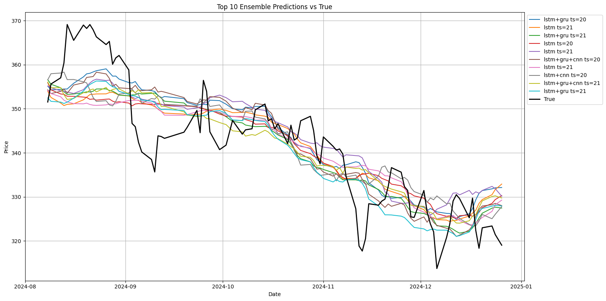

# 감성 및 거래 특성을 반영한 시계열 딥러닝 앙상블을 통한 KOSPI200 지수 예측

> 가천대 × 세종대 연구트랙 · 팀 **박박박사** (박재현, 박종원) · 2025-08-22

한국어 뉴스 감성(klue/bert-base 이진 분류)과 거래 특성(거래량·변동률)을 결합한 60차원 다변량 시계열 입력으로 KOSPI200 **T+1 종가**를 예측. LSTM / GRU / CNN-LSTM seed ensemble 위에 hybrid ensemble(soft voting)을 적용.



## 핵심 결과

| 실험 | 입력 | RMSE | MAE | R² |
|---|---|---|---|---|
| 결과 1 | 종가만 | 15.4074 | 11.3164 | -0.0125 |
| 결과 2 | + 뉴스 감성 pos/neg | 12.1246 | 10.0023 | 0.3730 |
| 결과 3 | + 순 감성 점수 (pos−neg) | 11.0593 | 9.1936 | 0.4783 |
| 결과 4 | + 하이퍼파라미터·시총 비중 | 10.0694 | 8.0649 | 0.4999 |
| **Hybrid Ensemble** | + 거래량·변동성 | **7.4357** | **6.1045** | **0.7286** |

Grid search(3584조건) 최종 선정 모델 (논문 Table 17):

| Ensemble | data_case | cap | scaler | time_step | RMSE | MAE | R² | MAPE | F1 |
|---|---|---|---|---|---|---|---|---|---|
| **LSTM+GRU** | C (감성+변동성) | cap_on | minmax | 20 | **7.564** | **6.065** | **0.712** | 0.0178 | **0.608** |
| LSTM+GRU+CNN | C | cap_on | minmax | 20 | 7.573 | 6.262 | 0.711 | 0.0183 | 0.541 |

방향성(상승/하락) 정확도는 약 60%. 회귀 지표는 hybrid 가 우수, 방향성은 CNN 계열이 상대적 강점.

백테스팅(발표자료): 감성 1 → 매수, 0 → 매도. 초기 자본 1천만 원, `y_pred` 기준 자본 추적, Buy&Hold 와 비교.

| 기업 | 전략 수익률 | Buy&Hold |
|---|---|---|
| 삼성전자 | +4.31% | +2.7% |
| 삼성바이오로직스 | +2.60% | +1.8% |
| 네이버 | +1.83% | +1.5% |
| KB금융 | -13.56% | — |

IT·바이오·플랫폼은 감성 전략 유효, 금융업은 부진. 거래 비용은 14장 발표본에 "수수료 0.05%, 슬리피지 0.02%", 32장 발표본에 "세금·수수료 미반영"으로 상이하게 기재됨.

## 파이프라인

```
빅카인즈 뉴스 (10개 기업, 1군 방송사 / 2군 경제지)
   └─ 03  klue/bert-base fine-tune (pos/neg, test acc 0.93)
   └─ 05~07  기사별 확률 → 일자별 평균
   └─ 07b  휴장일 병합 → 1군×3 + 2군×1 → ÷4
KRX KOSPI200 ── 01  정제
기업별 주가 ──── 08  거래량·변동률
   └─ 09  10기업 × [neg, pos, emotion, calculate, trading, change] = 60차원
          21일 윈도우 → LSTM/GRU/CNN-LSTM seed ensemble → hybrid ensemble
   └─ [grid search]  3584조건 → results/*.json (상위 60)
   └─ 10, 11  시각화   └─ 12, 13  백테스팅
```

단계별 입력/출력 파일 추적은 [docs/pipeline.md](docs/pipeline.md) 참고.

## 리포 구조

```
.
├── README.md
├── LICENSE                         ← MIT
├── requirements.txt
├── docs/
│   ├── pipeline.md                 ← 단계별 입력→처리→출력 상세
│   ├── paper_kospi200_sentiment_ensemble.pdf
│   ├── presentation_kospi200_sentiment_ensemble.pptx   ← 발표 14장
│   ├── presentation_kospi200_sentiment_ensemble.pdf
│   └── presentation_full_32p.pdf                       ← 상세 발표 32장 (근거·설계 선택 이유)
├── notebooks/  17개                ← 실행 순서대로 번호
│   ├── 01_kospi200_preprocessing.ipynb
│   ├── 02_kospi200_eda.ipynb
│   ├── 03_sentiment_finetune_klue_bert.ipynb
│   ├── 03a_sentiment_finetune_kobert_3class_abandoned.ipynb
│   ├── 04_sentiment_inference_test.ipynb
│   ├── 05_news_group_split_and_topicality_score.ipynb
│   ├── 06_sentiment_inference_first_second.ipynb
│   ├── 07_sentiment_daily_aggregate.ipynb
│   ├── 07b_holiday_merge_and_group_weighting.ipynb  ← 1군/2군 3:1 가중
│   ├── 07c_normalization_methods_experiment.ipynb
│   ├── 08_trading_volume_volatility.ipynb
│   ├── 09_lstm_gru_cnn_hybrid_ensemble.ipynb      ← 핵심
│   ├── 10_results_top_models_visualization.ipynb
│   ├── 11_results_ensemble_visualization.ipynb
│   ├── 12a_backtesting_topicality_sentiment_preprocessing.ipynb
│   ├── 12_backtesting_preprocessing.ipynb
│   └── 13_backtesting.ipynb
├── data/
│   ├── README.md                   ← 데이터 출처·폴더 설명
│   └── processed/                  ← 원문 제거된 집계 csv (약 11MB)
│       ├── kospi200/                ← KRX 원본 + 01 노트북 산출 cleaned csv
│       ├── sentiment/01_~06_       ← 일자별 평균 → 휴장일 → 가중 → 최종 입력
│       ├── trading_volume_volatility/
│       ├── market_cap/
│       ├── calculate_index/
│       ├── topicality_score/
│       ├── backtesting_2025/
│       └── backtesting_2018_2019/
└── results/
    ├── individual_model_results.json   ← 단일 모델 상위 60 (y_true/y_pred/dates 포함)
    ├── ensemble_model_results.json     ← 앙상블 상위 60
    ├── all_model_results.csv / all_ensemble_data.csv
    └── figures/                        ← 노트북 내장 그림 62장 추출
```

## 데이터

| 구분 | 출처 | 기간 |
|---|---|---|
| 뉴스 | 빅카인즈 (한국언론진흥재단). 1군 방송사 KBS·MBC·SBS·JTBC·tvN, 2군 경제지 12개 | 2022-01-27 ~ 2024-12-30 |
| KOSPI200 지수·기업 주가·거래량 | KRX | 동일 |
| 대상 기업 | 현대차, KB금융, 기아, LG화학, LG에너지솔루션, 네이버, POSCO홀딩스, 삼성바이오로직스, 삼성전자, SK하이닉스 | |

뉴스 원문은 저작권상 미포함. 집계 결과(확률·점수)만 `data/processed/` 에 포함.

## 모델 설정

| 항목 | 값 |
|---|---|
| 감성 모델 | `klue/bert-base`, 2-class, 학습 39,456건(pos 19,673 / neg 19,783), epochs 5, batch 16, lr 5e-5, max_length 512. 샘플 200건 수동 검증 정확도 93% |
| 시계열 모델 | LSTM / GRU / CNN-LSTM, units `[100,50,25]`, dropout `[0.3,0.15,0.1]` |
| 입력 | 21일 윈도우 × 60피처, MinMaxScaler |
| 학습 | Adam(lr 0.001, β1 0.9, β2 0.999, ε 1e-8), MSE, batch 64 (논문) / 16 (노트북), EarlyStopping |
| 분할 | train 0.71 / val 0.151 / test 0.139, 시계열 순서 보존 |
| 앙상블 | seed ensemble 평균 → hybrid 평균 (soft voting) |
| 설계 선택 근거 (32장 발표본) | 3:1 가중은 2:1~4:1 민감도 분석 후 선택. Softmax 가 Sigmoid 보다 결과 좋아 채택. MinMax 가 Softmax 스케일러보다 민감해 채택 |
| 지표 | RMSE, MAE, R², MAPE, F1(방향성) |

## 환경

| | |
|---|---|
| 시계열 | Python 3.10, TensorFlow 2.10.0, CUDA 11.2, cuDNN 8.1, NumPy 1.23.5 |
| 감성 | transformers 4.53.1, torch 2.x |
| 실행 | 전처리·시각화 Google Colab, grid search 로컬 VS Code |

```bash
pip install -r requirements.txt
```

노트북 상단의 `/content/drive/MyDrive/...` 경로를 로컬 경로로 바꾸면 실행 가능.

## 리포에 포함되지 않은 것

| 항목 | 이유 |
|---|---|
| 빅카인즈 뉴스 데이터 전부 (원문, 제목, 키워드, 추출 문장) | 저작권. 기사 수·감성 확률 등 **파생 집계값만** 포함 |
| 감성 모델 학습 데이터 (`NewsResult_*_pos/neg.csv`) | 저작권 + 원본 미보존 |
| 감성 모델 가중치 `model.safetensors` (~440MB) | 원본 미보존. tokenizer/config 만 남음 |
| grid search 스크립트 (`.py`) | 로컬 실행본 미보존. 로직은 `09_*.ipynb` 와 동일, 조건은 `docs/pipeline.md` [G] 참고 |

## 재학습 (추후 과제)

이 리포는 **실행 결과와 파이프라인 기록**이 목적임. 모델은 재학습하지 않았고, 결과 수치는 전부 `results/` 의 원본 json·csv 기준. 재학습 시 아래 순서.

| 단계 | 필요 입력 | 리포 내 존재 | 예상 시간 (H200 1장) |
|---|---|---|---|
| 03 감성 모델 fine-tune | 빅카인즈 긍정/부정 기사 각 20,000건 export | ✗ 재수집 필요 | 10~20분 |
| 06 전체 기사 추론 | 기업별 1군/2군 기사 원문 | ✗ 재수집 필요 | 5~10분 |
| 07~07b 집계·가중 | 06 출력 | — | 5분 |
| 09 seed + hybrid ensemble | `data/processed/kospi200/`, `sentiment/06_*`, `trading_volume_volatility/` | ✓ **지금 실행 가능** | 5분 |
| [G] grid search 3584조건 | 09 와 동일 | ✓ 실행 가능 | 직렬 약 50시간, 8 병렬 6~7시간 |
| 10~11 시각화 | `results/*.json` | ✓ | 5분 |

주의:
- GPU 비결정성·seed 차이로 `results/` 의 수치와 **소수점 수준 동일 재현은 불가**. 유사 수준 재현이 목표.
- 03·06 은 빅카인즈 재수집이 선행돼야 함. 2022-01-27~2024-12-30, 기업 10개, 1군(KBS, MBC, SBS, JTBC, tvN)/2군(경제지 12개) 분리. 긍정/부정 학습셋(각 2만 건)으로 분류기를 학습한 뒤 나머지 기사에 pos/neg 부여.
- 09 만 재실행할 경우 기존 감성 확률(`sentiment/06_*`)을 그대로 입력으로 사용.
- 환경: `requirements.txt`. TF 2.10.0 은 CUDA 11.2 / cuDNN 8.1 / NumPy 1.23.5 조합 필수.

## 논문 ↔ 코드 차이

- 논문 3.1.1은 "SKTBrain KoBERT" 로 서술되어 있으나 실제 사용 모델은 **`klue/bert-base`** (`config.json`, 노트북 `MODEL_NAME` 기준).
- Seed ensemble 모델 수: 논문 5, 노트북 9~10.
- 감성 모델 정확도: 노트북 validation `eval_accuracy` 0.99, 논문·발표의 93%는 별도 샘플 200건 수동 검증 기준.
- 1군/2군 경계 기준: 발표자료는 "인지도와 댓글 수", 논문은 방송사/경제지 구분.
- 논문 Table 9 (GRU result) 의 model 열이 `LSTM` 으로 표기됨 (오타).
- 32장 발표본 21쪽의 Gradient Clipping, LR Decay, Model Checkpoint 는 노트북 코드에 없음 (EarlyStopping `restore_best_weights=True` 만 존재).
- 발표본 학습 건수 "긍정 19,473" 은 노트북 출력 19,673 의 오타.

## 참고 문헌

- Liu, F. et al. (2024). *Application of an ANN and LSTM-based Ensemble Model for Stock Market Prediction.* [arXiv:2410.20253](https://arxiv.org/abs/2410.20253)
- 양혁진, 최종민, 박찬정 (2024). *감정분석과 GRU 모델 기반의 주가지수 예측 및 분석: 코스피 200 에너지/화학을 중심으로.*
- KLUE: [klue/bert-base](https://huggingface.co/klue/bert-base)
- 전체 목록은 `docs/paper_kospi200_sentiment_ensemble.pdf` 참고문헌 참조.

## License

MIT. 코드·문서·파생 집계 데이터에 적용. 빅카인즈 뉴스 원문과 KRX 원본 데이터는 각 제공처 약관을 따름.
